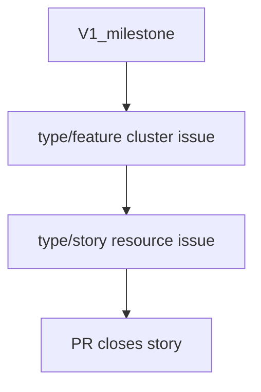

# Label Strategy

The **canonical label taxonomy** for `markheydon` repositories is maintained in
[`markheydon/solo-dev-board - plan/LABEL_STRATEGY.md`](https://github.com/markheydon/solo-dev-board/blob/main/plan/LABEL_STRATEGY.md).

This repository uses the same prefixed label groups. Pull request titles follow
[`solo-dev-board - plan/PULL_REQUEST_POLICY.md`](https://github.com/markheydon/solo-dev-board/blob/main/plan/PULL_REQUEST_POLICY.md).

## Backlog shape in this repository

How milestones, GitHub issues, and pull requests relate in this project:

| Repo term | GitHub artefact | Label / title |
|-----------|-----------------|---------------|
| Release increment | Milestone (for example V1.0) | (no `type/*` on milestone) |
| API **cluster** ([entity map](../docs/explanation/api-entity-map.md)) | Tracking issue | `type/feature`, `[Feature] Implement … cluster` |
| SDK **resource** (or report) | Implementation issue | `type/story`, `[Story] Implement … resource` |
| Cross-cutting prerequisite | Issue (uncommon here) | `type/enabler` when it unlocks many stories; otherwise `type/chore` |

Rules:

- **`type/epic`**: not used here while the **milestone** carries the release theme (solo-dev-board: epics are not milestone buckets). Prefer linking parent **feature** cluster issues, not hunting for an epic.
- **Cluster = feature issue**: entity-map “cluster” and `[Feature]` trackers are the same thing (for example #65–#68).
- **PRs close stories**: title `[Story] Implement … (#NNN)`; `Closes #NNN` on the story; **Related** link to the parent feature (for example `#65`). Do not `Closes` the parent unless you intend to close the whole cluster tracker.
- **`[Feature]` PR titles** only when closing a `type/feature` tracker itself (for example cluster completion housekeeping)—not for per-resource SDK work.
- **Git “feature branch”** (`feature/bills-resource`) is a naming convention only; it is unrelated to `type/feature`.
- **`type/enabler` vs `type/chore`**: use `type/enabler` when the work is a technical prerequisite for multiple stories (contract or infra). Use `type/chore` for maintenance, verification (#134), sample backfill, and CI. Both are valid; do not relabel chores as enablers unless the solo-dev-board enabler definition clearly fits.

---

## Required labels

### Issues

Every issue should have:

| Group | Cardinality | Examples |
|-------|-------------|----------|
| `type/*` | exactly one | `type/story`, `type/chore`, `type/documentation` |
| `status/*` | exactly one | `status/todo`, `status/in-progress`, `status/done` |
| `priority/*` | exactly one | `priority/medium` (default), `priority/high` |

`size/*` is optional at creation; add during planning when useful.

Issue titles use a `[Type]` prefix matching the `type/*` label (for example `[Story] Implement Users resource`).

### Pull requests

Every pull request should have:

| Group | Cardinality | Examples |
|-------|-------------|----------|
| `type/*` | exactly one | same vocabulary as issues |
| `status/*` | exactly one | `status/in-review` (open), `status/done` (merged/closed) |
| `priority/*` | exactly one | `priority/medium` unless triaged otherwise |

PR titles use `[Type] <imperative summary> (#issue)` when a tracking issue exists.

---

## Type labels

| Label | Use for |
|-------|---------|
| `type/epic` | Named product theme spanning multiple features |
| `type/feature` | Groups related stories (for example Foundations cluster #55) |
| `type/story` | User-facing SDK deliverable |
| `type/enabler` | Technical prerequisite that unblocks stories |
| `type/test` | Test coverage deliverable |
| `type/bug` | Unexpected or broken behaviour |
| `type/chore` | Maintenance, CI, dependencies, governance |
| `type/documentation` | Documentation-only changes |

---

## Status labels

| Label | Use for |
|-------|---------|
| `status/todo` | Ready to start, not yet in progress |
| `status/in-progress` | Actively being worked |
| `status/blocked` | Waiting on external dependency |
| `status/ice-box` | Shelved; not in active queue |
| `status/in-review` | Open PR awaiting review |
| `status/done` | Closed issue or merged/closed PR |

---

## Priority labels

| Label | Use for |
|-------|---------|
| `priority/critical` | Blocking all progress or production |
| `priority/high` | Current release / sprint |
| `priority/medium` | Default for new work |
| `priority/low` | Nice to have; deferrable |

---

## Size labels (optional)

`size/xs` through `size/xl` - effort estimate; add at planning time, not required on creation.

---

## Issue template defaults

| Template | Default `type/*` | Default `status/*` | Default `priority/*` |
|----------|------------------|--------------------|-----------------------|
| `feature_request.yml` | `type/story` | `status/todo` | `priority/medium` |
| `story_request.yml` | `type/story` | `status/todo` | `priority/medium` |
| `chore_request.yml` | `type/chore` | `status/todo` | `priority/medium` |
| `bug_report.yml` | `type/bug` | `status/todo` | `priority/medium` |

Dependabot PRs receive `type/chore`, `status/in-review`, and `priority/medium` via [`.github/dependabot.yml`](../.github/dependabot.yml).

---

## Deprecated labels (safe to delete)

These unprefixed labels are **retired** in this repository. Remove them from GitHub once no open issues or PRs reference them:

`story`, `bug`, `epic`, `documentation`, `enhancement`, `dependencies`, `blocked`, `priority-high`, `not-started`, `feedback-required`, `out-of-scope`, `waiting-for-details`

---

## Decision guide

1. Large theme spanning multiple features? → `type/epic` or `type/feature`. In this repo, prefer `type/feature` for [API entity map](../docs/explanation/api-entity-map.md) clusters; reserve `type/epic` unless a named theme spans multiple milestones.
2. User-facing SDK capability? → `type/story`
3. Unblocks other stories technically? → `type/enabler`
4. Test-only deliverable? → `type/test`
5. Broken behaviour? → `type/bug`
6. CI, deps, tooling, governance? → `type/chore`
7. Docs only? → `type/documentation`
8. Open PR? → `status/in-review`; merged/closed → `status/done`
9. Unsure on priority? → `priority/medium`

For full definitions, colours, and AI collaborator guidance, see the
[solo-dev-board label strategy](https://github.com/markheydon/solo-dev-board/blob/main/plan/LABEL_STRATEGY.md).
